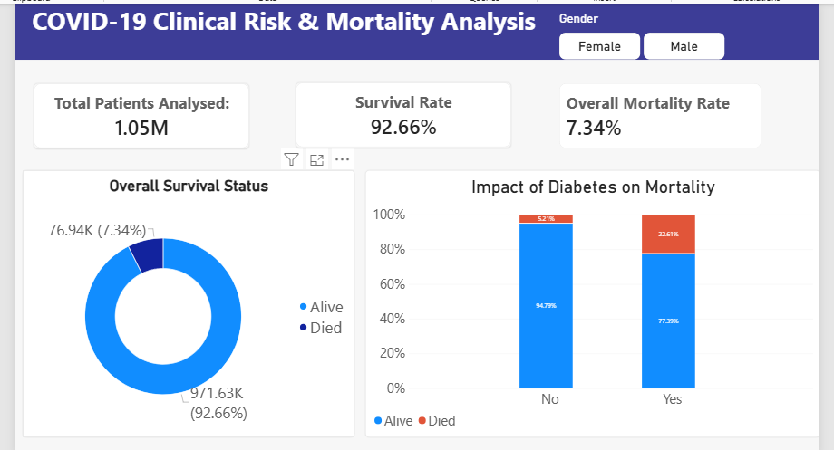

# 🏥 COVID-19 Clinical Risk & Mortality Analysis (MySQL + Power BI)

## 📌 Project Overview
An end-to-end data analytics project analyzing **1.04 million+ patient clinical records** to identify key mortality risk factors and hospital resource dependencies during COVID-19.

## 📊 Dashboard Preview

## 🛠️ Tools & Skills Demonstrated
* **Database & Querying (MySQL):** Imported 1.04M+ records, handled missing/placeholder data (`9999-99-99`, `97/99`) using `CASE WHEN` and modular `VIEWs`, and performed cohort analysis using Window Functions (`PARTITION BY`).
* **Data Visualization (Power BI):** Built an interactive executive dashboard featuring DAX measures (`CALCULATE`, `DIVIDE`), KPI cards, 100% stacked column comparisons, and dynamic gender slicers.

## 🔍 Key Business Insights
* **Overall Survival Rate:** Out of **1.05M** patients analysed, **92.66%** survived while the overall mortality rate stood at **7.34%**.
* **Impact of Diabetes:** Patients with pre-existing **Diabetes** faced a **4x higher mortality rate (22.61%)** compared to non-diabetic patients (**5.21%**).

